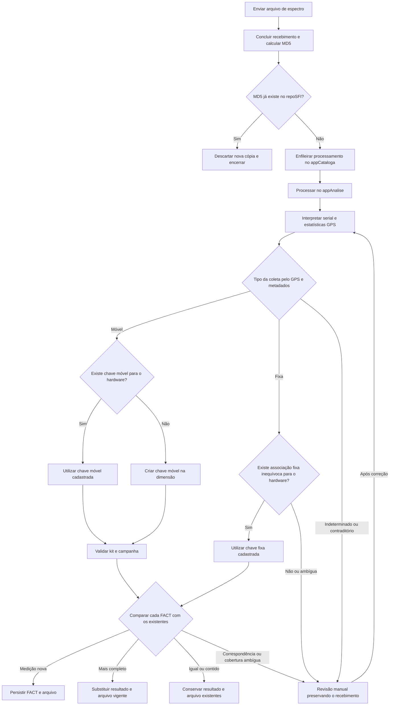

# Planejamento da ingestão convencional, manual e de drive-test

Data inicial: 08/10/2026. Consolidação: 14/10/2026.
Status: decisões de domínio consolidadas para planejamento. A implementação
depende da atualização dos contratos arquiteturais aplicáveis e da revisão de migração.
Escopo: appCataloga, WebFusion, catálogo analítico e contratos de ingestão.
Índice de planejamentos: [README.md](README.md).

## 1. Objetivo e decisões consolidadas

Integrar os uploads ao catálogo e processamento do appCataloga, preservando a
coleta convencional. Resolver identidade e contexto pelo conteúdo sempre que
possível, com intervenção somente para dados insuficientes, ambíguos ou divergentes.

- Existem três entradas: coleta convencional de estações fixas, upload manual
  de arquivos dessas estações e upload de drive-tests de espectro, ROMES e RNI.
- O canal de entrada não cria outra identidade para a mesma estação/medição.
  Upload fixo e coleta convencional convergem para os mesmos registros analíticos.
- MD5 existente no repoSFI: descartar a nova cópia e encerrar o envio. Não
  reprocessar, recuperar tasks, corrigir associação ou criar outro vínculo por
  consequência desse reenvio.
- A correspondência entre nome operacional e hardware será resolvida na própria
  `RFDATA.DIM_SPECTRUM_EQUIPMENT`, acrescentando `NA_HWSERIAL`.
- CelPlan/RFEye usam seus nomes oficiais completos como seriais. Para CelPlan,
  o nome operacional abreviado e o nome oficial ficam na mesma linha da dimensão.
- Para espectro, as estatísticas GPS retornadas pelo appAnalise permitem
  classificar a dispersão da medição sem exigir trajetória completa.
- Um analisador pode operar dentro de ERMx/UMS300 e depois em drive-test.
  Serial identifica hardware; contexto da medição resolve seu uso fixo ou móvel.
- ROMES/RNI não são processados pelo appAnalise e são móveis por definição.
- Kit e campanha são obrigatórios para todos os drive-tests.
- Todo FACT_SPECTRUM, fixo ou móvel, passa pela mesma comparação: medição nova,
  resultado mais completo ou resultado igual/menos completo que o vigente.
  Conservar os FACTS e arquivos de maior cobertura analítica.
  MD5 diferente, tamanho maior e nome igual não comprovam medição nova.
- Movimento caracteriza a coleta e ajuda a resolver sua associação; não cria
  uma regra diferente de inserção/substituição para o FACT.
- A premissa de arquivos móveis completos não dispensa a comparação dos FACTS
  quando outro arquivo produzir resultados correspondentes.

## 2. Os três fluxos de entrada

| Entrada | Informação de origem | Tratamento | Resultado |
|---|---|---|---|
| Convencional, estações fixas | Host e caminho remoto conhecidos pelo appCataloga | Descoberta, backup e processamento existentes; associação host–hardware e MD5 da cópia estável | Catálogo, FACTS e arquivos fixos |
| Upload manual de arquivo fixo | Identidade e GPS do payload; caminho remoto original pode ser desconhecido | Resolver estação/hardware e comparar com os dados convencionais | Mesma identidade analítica e maior cobertura vigente |
| Drive-test de espectro | Identificação e GPS do payload; kit e campanha | appAnalise e mesma comparação dos FACTS utilizada no fixo | Arquivo, espectros vigentes e catálogo móvel |
| Drive-test ROMES/RNI | Família declarada, kit e campanha | Recebimento e catalogação, sem appAnalise | Arquivo catalogado e disponível para download |

As duas últimas linhas são modalidades da terceira entrada, drive-test.
O rótulo escolhido no formulário não prevalece sobre identidade/classificação
resolvidas pelo servidor. No espectro manual, não exigir a escolha da estação
como origem da verdade: resolver pelo processamento e pela dimensão; solicitar
correção somente quando necessário.

Isso altera o contrato futuro do upload fixo. A API atual ainda exige estação
e apenas grava arquivos, conforme a [arquitetura do WebFusion](../../src/webfusion/.instructions/ARCHITECTURE.md#upload-de-arquivos-no-webfusion). A retirada dessa
seleção obrigatória depende da revisão arquitetural, não ocorre nesta etapa.

### Fluxograma do upload manual de espectro

Este diagrama detalha a entrada manual de espectro, fixo ou móvel. O convencional
mantém descoberta/backup e fornece a origem operacional; após processamento,
compartilha as regras de resolução e comparação analítica. ROMES/RNI seguem
o caminho de catalogação descrito na seção 7, sem passar pelo appAnalise.



"Tipo da coleta" interpreta o movimento pelas estatísticas do payload, incluindo
o caso de coordenada manual. Não é simplesmente a presença de GPS ligado nem
uma categoria selecionada pelo usuário.

A consulta móvel considera a configuração móvel: encontrar o mesmo serial
somente numa ERMx/UMS300 não autoriza reutilizar a chave fixa para o drive-test.
Criar a chave móvel preserva a identificação física e o registro fixo existente.
No fixo, não criar estação automaticamente; serial sem associação inequívoca
fica para revisão. Serial não interpretável também exige resolução, não criação
de uma chave fictícia.

Kit/campanha continuam obrigatórios no móvel. Se faltarem ou estiverem inválidos,
manter o recebimento pendente e completar seus metadados antes de publicar.
As ações sobre arquivo na comparação respeitam contribuições compartilhadas e
substituição transacional descritas na seção 8.

O diagrama não substitui os estados das filas.
Claim, retries e conclusão convencionais permanecem com o entrypoint existente.
Duplicidade também não autoriza apagar o arquivo vigente nem dispensar a
finalização operacional da task convencional. O índice diferencia consulta,
reserva e publicação; o próprio hash reservado pelo trabalho não é um novo envio
duplicado durante retry.
Correções de contexto reutilizam metadados já extraídos quando possível, sem
exigir outro upload ou processamento idêntico.

Após resolver hardware, movimento e associação, todos os espectros convergem
para a mesma comparação de FACTS. Os campos exigidos pelo contexto continuam
válidos, como kit/campanha no móvel, mas não mudam essa decisão analítica.
ROMES/RNI seguem separados somente porque não produzem FACTS neste escopo.

## 3. Identidade resolvida em DIM_SPECTRUM_EQUIPMENT

Estrutura alvo da dimensão:

```text
ID_EQUIPMENT
FK_EQUIPMENT_TYPE
NA_EQUIPMENT
NA_HWSERIAL
```

- `ID_EQUIPMENT`: identifica a configuração lógica referenciada pelos FACTS.
- `FK_EQUIPMENT_TYPE`: conserva a classificação existente da configuração;
  ERMx/UMS300 continuam identificando suas famílias operacionais.
- `NA_EQUIPMENT`: nome operacional correspondente à estação ou ao contexto
  móvel, com conciliação direta ao nome do host quando fixo.
- `NA_HWSERIAL`: identificação estável do hardware, interpretada por família.
  Firmware fica fora dessa identidade.

Exemplos de configurações; IDs são ilustrativos:

| ID | Tipo | NA_EQUIPMENT | NA_HWSERIAL |
|---|---|---|---|
| 1 | ERMx | ERMxES01 | TEKTRONIX,SA2500,B040237 |
| 2 | ERMx | ERMxES01 | ROHDE&SCHWARZ,EB500,100.633/012 |
| 3 | Tektronix SA2500 | mobile | TEKTRONIX,SA2500,B040237 |
| 4 | CelWireless | CWSM211006 | cwsm21100006 |
| 5 | RFEye | RFeye002095 | rfeye002095 |

Para analisadores, a composição fabricante/modelo/serial acima ilustra o
identificador sem firmware; sua normalização final integra a revisão da chave.
`mobile` é o nome lógico do exemplo, não identificação de kit ou campanha.

Cada linha distingue a combinação lógica de operação e hardware. A mesma
estação pode ter vários registros ao usar instrumentos diferentes; o mesmo
hardware pode aparecer em configuração fixa e móvel. Não criar unicidade global
somente sobre `NA_EQUIPMENT` ou somente sobre `NA_HWSERIAL`.

A resolução precisa considerar contexto e combinação operacional–hardware.
A chave e os índices finais devem ser definidos antes da migração, inclusive
para registros legados com serial desconhecido. Não selecionar arbitrariamente
a primeira linha encontrada por nome ou serial.

### CelPlan e RFEye

Na CelPlan, `CWSM211006` e `cwsm21100006` identificam a mesma unidade.
O primeiro é o nome operacional abreviado; o segundo é o nome oficial/serial.
A regra vale para toda a série CWSM, com suas famílias e exceções históricas,
não como alias isolado desta estação. Não converter por simples remoção de zeros.

No RFEye, nome e serial correspondem ao identificador completo, por exemplo
`RFeye002095` / `rfeye002095`, respeitando normalização de caixa.
Não extrair apenas os dígitos como se fossem outro contrato de serial.

A dimensão registra esses pares na origem. O fluxo convencional fornece host
e identificação do payload para registrar/reconciliar a associação. O upload
consulta a dimensão a partir da identificação processada e resolve o nome
operacional do registro encontrado; se houver múltiplos candidatos, usa contexto,
local/período conhecidos e evidências da medição.

`RFFUSION_SUMMARY.HOST_EQUIPMENT_LINK` já concilia os nomes atualmente.
No modelo alvo, passa a projetar a correspondência estabelecida na dimensão.
Não criar outra BRIDGE de nomes nem repetir heurísticas no upload.
Os bancos e seus IDs continuam separados: conciliar identidade não significa
fundir `BPDATA.HOST` e a dimensão analítica.

### Troca e movimentação de instrumento

O Tektronix X pode produzir medições fixas em ERMx A, móveis no kit B e depois
fixas novamente em A. Seu identificador físico não muda. Os FACTS conservam a
configuração correta de cada medição, sem transferir o histórico ao atualizar
o cadastro atual.

A dimensão registra as configurações; os períodos observados vêm das medições.
Não exigir cadastro de retirada/reinstalação para cada saída a campo.
Uma BRIDGE temporal de inventário não é pré-requisito deste fluxo.

Preservar IDs e vínculos históricos na migração. Não atribuir o instrumento
instalado hoje a todo o histórico de uma estação. Associações desconhecidas
permanecem desconhecidas até haver evidência; não fabricar backfill.

## 4. Payload e interpretação por família

Contrato e exemplos detalhados:
[Payload do appAnalise](../../src/appCataloga/server_volume/usr/local/bin/appCataloga/appAnalise/PAYLOAD.md)
e [exemplos.json](drive-test/exemplos.json).

| Família | Receiver observado | Interpretação |
|---|---|---|
| EB500 | ROHDE&SCHWARZ,EB500,100.633/012,V04.90-4072.8710.00 | Fabricante, modelo, serial e firmware |
| SA2500 | TEKTRONIX,SA2500,B040237,7.050 | Fabricante, modelo, serial e firmware |
| CelPlan | CWSM22010045 | Nome oficial completo como serial |
| RFEye | RFeye002095 | Nome completo como serial |

Não forçar todas as famílias a quatro componentes. Preservar `Receiver` bruto
e sua interpretação antes de substituir o nome pelo hostname operacional.
Serial é string: manter letras, pontos, barras e zeros.

`Spectra` pode ser objeto ou lista. Interpretar identidade e GPS por espectro;
várias faixas não equivalem a várias aquisições ou conjuntos GPS independentes.
O exemplo RFEye repete o mesmo resumo GPS nos 19 espectros.

`RelatedFiles.Task` é informação complementar: CelPlan retorna `Undefined`,
enquanto RFEye retorna `Script2026v1LoggerFixed.cfg`. Não exigir o texto
`Fixed Station` para reconhecer dados fixos. `DataType` apresenta valores
`1`, `2`, `67` e `1000`; não tratá-lo como enumeração universal fixa/móvel.

Detector, tipo de traço, unidade e procedimento conservam seus significados.
Não usar `FK_TRACE_TYPE`, detector RMS ou família do arquivo para codificar
mobilidade. Frequências do payload chegam em Hz; preservar a conversão atual
para MHz na persistência espectral.

## 5. Identificação de movimento durante a coleta por estatísticas GPS

O appAnalise já retorna `Status`, `Count`, `Latitude`, `Longitude`,
`Latitude_std`, `Longitude_std`, `stdRange` e indicadores de origem/edição.
A classificação considera esse resumo; não depende de obter a trajetória completa.
O objetivo é identificar se o arquivo representa uma coleta com movimento,
antes de resolver a associação operacional dos seus resultados. Essa informação
não decide se um FACT é novo ou substitui outro: isso depende da comparação
da mesma medição e de sua completude.

### Regras de classificação

| Condição observada | Tratamento |
|---|---|
| Coordenada manual, Status=-1, coordenadas válidas | Caso fixo manual nos formatos exemplificados; conferir metadados disponíveis e encaminhar contradições |
| GPS ligado, Status=1, quantidade suficiente e baixa dispersão | Classificação fixa pelo GPS, confrontada com identidade e informações explícitas de aquisição |
| GPS ligado, Status=1, quantidade suficiente e alta dispersão | Classificação móvel pelo GPS |
| Drive-test explicitamente identificado, mas momentaneamente parado | Conservar contexto móvel; baixa dispersão não apaga a informação explícita |
| GPS ausente, contagem insuficiente, estatísticas inválidas ou evidências contraditórias | Resolver pelas demais evidências confiáveis ou manter pendência específica |

Nos exemplos manuais, `Count=1` e desvios zero não representam leituras que
comprovaram estabilidade. `Status=-1` também não significa coordenada inválida:
é diferente de latitude/longitude sentinela de GNSS ausente.

Para GPS ligado, usar quantidade mínima e limiar de dispersão configuráveis em
`config.py`. Não interpretar campo ausente como zero. Confirmar como o produtor
filtra leituras inválidas/outliers e o significado de `stdRange` antes de utilizá-lo.
Não somar `Count` repetido entre faixas nem recalcular o desvio original apenas
com as médias dos espectros.

### Comparação concreta em metros

Uma aproximação local para combinar os dois eixos é:

```text
escala = pi * 6371000 / 180 metros por grau
sigma_lat_m = escala * Latitude_std
sigma_lon_m = escala * cos(Latitude em radianos) * Longitude_std
dispersao_horizontal_m = sqrt(sigma_lat_m² + sigma_lon_m²)
```

| Exemplo | GPS | Dispersão horizontal aproximada |
|---|---|---|
| EB500, Anápolis | Coordenada manual | Não estimada por série GPS |
| SA2500, Linhares | Coordenada manual | Não estimada por série GPS |
| EB500, Brasília, fixo | 168 leituras | 63,38 m |
| CelPlan, CWSM22010045 | GPS ligado, 11 espectros | 1,83–3,66 m por espectro |
| RFEye, RFeye002095 | GPS ligado, resumo repetido em 19 espectros | 4,02 m |
| EB500, Aracaju, drive-test | 5176 leituras | 3.409 m |

Um corte experimental de 100 m separa os exemplos medidos acima, mas não é um
limiar aprovado de produção. O conjunto possui apenas um arquivo móvel;
faixas/janelas repetidas não aumentam a quantidade de aquisições independentes.
Calibrar o limite com mais arquivos e situações de GPS ruidoso.

Dispersão não é distância percorrida nem trajetória. A tolerância de lookup de
sites fixos não deve ser reutilizada automaticamente como limiar dessa classificação.
Mudança de rótulo de município também não comprova movimento: no CelPlan,
`Location` alterna entre Belo Horizonte e Contagem com médias a poucos metros.

No convencional, o host permanece origem operacional conhecida. Se o conteúdo
contradisser o contexto fixo esperado, tratar a divergência antes de publicar;
não redirecionar silenciosamente medições ou inventar kit/campanha.

## 6. Resolução automática e intervenções

No espectro manual, executar: receber → MD5 → extrair payload → interpretar
hardware e movimento pelo GPS → resolver a configuração na dimensão → comparar
os FACTS pela regra comum → persistir o resultado vigente.

- Fixo com associação inequívoca: resolver estação automaticamente e comparar
  com os resultados convencionais, sem exigir seleção inicial pelo usuário.
- Móvel: resolver a configuração móvel, exigir kit/campanha e conservar a mesma
  identidade física usada antes em uma estação fixa; comparar os FACTS pelas
  mesmas regras de novidade e completude usadas no fixo.
- Se a configuração móvel para aquele hardware já existir, reutilizar sua chave.
  Se não existir e a identificação for válida, criar a configuração móvel na
  dimensão, sem transformar ou excluir a configuração fixa do mesmo hardware.
- Mesmo serial em várias configurações: usar a classe fixa/móvel e evidências
  de local/período; não decidir pelo primeiro registro ou somente pelo vínculo atual.
- Instrumento novo em estação conhecida: registrar uma nova combinação quando
  origem e identidade estiverem comprovadas; não sobrescrever a combinação antiga.
- Sem associação fixa suficiente: manter o recebimento e solicitar correção/
  confirmação específica. Não cadastrar estação desconhecida pelo upload.
- Se o processamento reconhecer drive-test em envio inicialmente declarado fixo,
  solicitar kit/campanha ausentes no mesmo recebimento, sem exigir reenvio dos bytes.
- ROMES/RNI: classificação móvel direta; hardware vem de informação declarada
  do kit quando disponível, sem afirmar que foi extraído do conteúdo.

Uma seleção divergente do usuário não altera o resultado silenciosamente.
Apresentar identificação encontrada, classificação e motivo da pendência.
Correções atuam sobre o recebimento existente; reenvio duplicado continua sendo
descartado por MD5. Correção de dados já publicados requer procedimento separado,
preservando contribuições compartilhadas e atualização de summaries.

## 7. Drive-tests: campanha, kit, catálogo e geografia

Campanha e kit são cadastros reutilizáveis obrigatórios. Selecioná-los por lote
e conservar seus valores por item ao entrar na fila. Alterações posteriores nos
seletores ou no cadastro do kit não reatribuem medições anteriores.

Cada original novo recebe identificação automática de aquisição/recebimento,
com original, derivados e resultados vinculados. Essa identificação garante
idempotência de retries; não exige formulário de sessão nem modelo geral de versões.
Recebimentos distintos podem contribuir para a mesma medição. O ID de recebimento
não torna um FACT necessariamente novo nem deve impedir reconhecer correspondência.
Um arquivo com várias faixas/instrumentos conserva associações no nível disponível.
Definir os vínculos físicos reaproveitando o catálogo de artefatos existente;
não presumir nova dimensão de instrumento ou seis tabelas adicionais.

Uma campanha pode usar vários kits e um kit pode participar de várias campanhas.
Não agrupar automaticamente aquisições por dia, município ou proximidade.

### Espectro móvel

Processar no appAnalise para obter metadados e espectros suportados. Comparar
cada FACT pela mesma regra do fixo: inserir se novo, atualizar se mais completo,
conservar o vigente se igual ou menos completo. Retry permanece idempotente.

Arquivos reexportados/recompactados com bytes diferentes passam pelo MD5 e podem
chegar à análise. Seus FACTS correspondentes ainda passam pela comparação comum;
MD5 não é uma segunda regra de identidade analítica. Não criar outro mecanismo
geral de equivalência de formatos nesta etapa. Mesmo kit, faixa e horário,
isoladamente, não bastam para fundir medições diferentes.

### ROMES e RNI

Catalogar original, MD5, família, kit, campanha e dados declarados disponíveis.
Não chamar appAnalise, inventar faixa espectral, detector ou FACT para habilitar
catálogo e download. Extração específica futura conserva o original e sua associação.

O catálogo móvel parte de aquisições/arquivos, sem JOIN obrigatório com
`FACT_SPECTRUM`. ROMES/RNI aparecem como catalogados, não como analisados.
Filtros mínimos: campanha, kit e família; período/instrumento quando conhecidos.

### Geografia disponível

GPS resumido permite classificação estatística e posição de referência.
Trajetória exige sequência real de pontos; não reconstruí-la a partir de médias.
Falta de trajetória não bloqueia catálogo e download.

Não criar um SITE por amostra nem fundir percursos pelo lookup de proximidade fixa.
Uma campanha não precisa de polígono único. Envelope de busca não representa
cobertura medida de RF. O uso de `GEOGRAPHIC_PATH` para dispersão fixa já motivou
auditoria de fragmentação; não reativá-lo automaticamente para resolver o móvel.

Geometria detalhada pode ser derivada por aquisição quando houver dados suficientes.
Definir tipo Mobile, eventual relação com SITE e contrato de apresentação antes
de implementar mapa móvel, preservando as consultas fixas.

## 8. MD5, hash-path e cobertura dos parciais

| Identificador | Finalidade |
|---|---|
| Host + caminho remoto + nome | Identidade operacional da coleta convencional |
| MD5 da cópia recebida | Reconhecer bytes já existentes no repoSFI |
| Identidade e cobertura dos FACTS | Reconhecer resultados da mesma medição, fixa ou móvel |
| ID do recebimento manual | Relacionar original, contexto, derivados e resultados |

O backup chama `shared/file_utils.build_server_filename()` a partir de
`appCataloga_file_bkp.py`: `p-<sha1(host_uid + ":" + remote_path)[:8]>--<filename>`,
com exceção CelPlan que conserva o nome original. Manter esse contrato.

O upload não recupera caminho remoto pelo nome da estação nem pelo nome do arquivo.
Não fabricar hash-path ou registrar a pasta de upload como origem remota.
Usar identificação própria do recebimento, preservando nome original e evitando
sobrescrita de conteúdos distintos com nomes iguais.

Calcular MD5 sobre cópia estável após transferência concluída, inclusive para
parcial de aquisição válido. Não calcular sobre arquivo remoto em crescimento.
Guardar MD5 do original mesmo quando houver MAT derivado; firmware e nome não
alteram essa regra. Um índice comum entre backup e upload evita varrer o repoSFI
a cada envio. Concorrência requer reserva e revalidação antes de novo processamento.

Duplicata encerra o novo envio, conservando arquivo, FACTS e tasks anteriores.
Recuperação de falha existente pertence ao seu fluxo operacional próprio.
Definir backfill de originais legados e alcance dos hashes após substituição/
remoção; ausência de hash não comprova conteúdo novo.

### Comparação comum dos FACTS e substituição

Uma cópia RFEye de 30 MB e sua continuação de 90 MB possuem MD5 distintos.
No convencional, host/caminho/nome permanecem iguais. No manual, o processamento
reconhece a mesma medição pela configuração e pela cobertura analítica.

Comparar estação/configuração de hardware, site, procedimento, detector, traço,
unidade, configuração espectral e início temporal. A integração manual não pode
criar outro equipamento apenas por usar um alias, ou perderá essa correspondência.

Identificar primeiro a mesma medição; depois comparar a completude. Fixo/móvel
e canal de entrada não escolhem algoritmos diferentes. No móvel, novas médias
GPS, dispersão ou geometria derivadas de um arquivo mais completo não devem,
isoladamente, tornar a medição independente. Uma identificação de recebimento
nova também não basta para declarar o FACT novo. Definir a correspondência
estável sem misturar configurações ou medições independentes.

Se uma cópia ampliada revelar movimento não visível na menor, a mudança de
classificação precisa ser reconciliada com a mesma medição, não usada sozinha
para duplicá-la. Esse caso integra a revisão da chave e dos vínculos.

| Resultado | Ação |
|---|---|
| Medição nova | Inserir FACT e vínculo |
| Mesma medição, cobertura igual ou contida | Conservar vigente |
| Mesma medição, maior cobertura compatível ou mais amostras válidas equivalentes | Atualizar FACT e vínculo para o arquivo mais completo |
| Interseção sem contenção, parâmetros incompatíveis ou segmentação diferente | Não aplicar ampliação automática |

08:00–09:00 seguido por 08:00–10:00 conserva o segundo; a ordem inversa não regride.
Maior tamanho não basta. Atualizar somente o término sem corrigir o download
não atende à regra.
Intervalo mais longo, sozinho, não comprova contenção quando houver lacunas
ou mudança de segmentação. Essas exceções não autorizam substituir resultados
incompatíveis apenas pela duração, seja a coleta fixa ou móvel.

Conservar FACTS exclusivos/compartilhados e arquivos ainda necessários. Remover
cópia anterior somente depois de publicar o novo resultado sem dependências
restantes. Escritas analíticas são transacionais; filesystem exige recuperação
própria. Conclusões concorrentes devem conservar a maior cobertura.

## 9. Integração, migração e preservação do runtime

- WebFusion recebe bytes, valida campos e apresenta resultado. appAnalise roda
  no appCataloga, fora da requisição HTTP.
- A fila convencional usa JOIN com HOST e histórico com FK_HOST obrigatório.
  A entrada manual precisa suportar recebimento anterior à resolução de estação
  e trabalhos móveis sem host. Especificar esse contrato na arquitetura.
- Preservar as chaves convencionais `(FK_HOST, NA_HOST_FILE_PATH, NA_HOST_FILE_NAME)`.
  Não substituí-las por MD5 nem fabricar host/caminho para o móvel.
- `get_or_create_spectrum_equipment()` procura hoje somente por nome, com
  `limit=1`. Precisa resolver combinações com `NA_HWSERIAL`, sem escolher
  arbitrariamente entre registros com o mesmo nome.
- O parser atual não conserva as estatísticas GPS na representação normalizada
  por espectro. Encaminhá-las antes de decidir contexto, sites e equipamento.
- A regra atual ERMx/UMS força hostname operacional. No fluxo futuro, resolver
  classe e hardware antes dessa associação, preservando o comportamento fixo válido.
- `DIM_SPECTRUM_FILE.NU_MD5` existe, mas `insert_file()` não o preenche e resolve
  tipo pelo hostname. Incluir identificação explícita de formato para ROMES/RNI.
- Reprocessamento convencional mantém `reset_reprocessed_file_lineage()`.
  Novo upload não apaga FACTS existentes antes de comparar por presumir linhagem.
- Falha entre gravar arquivo, registrar trabalho e publicar exige recuperação
  durável, sem outro upload ou aquisição duplicada.

A migração da dimensão deve reconciliar nomes/aliases, manter IDs sempre que a
identidade não mudar, auditar colisões e preservar seriais desconhecidos.
Revisar a agregação por estação quando houver mais de uma configuração/equipamento.

`HOST_EQUIPMENT_LINK` será recomposto a partir dos pares da dimensão, com revisão
de compatibilidade. Preservar nomes, colunas e granularidade dos contratos
`HOST_LOCATION_SUMMARY`, `MAP_SITE_SUMMARY`, `MAP_SITE_STATION_SUMMARY` e
`SITE_EQUIPMENT_OBS_SUMMARY`. O móvel não transfere suas medições para a estação
onde o hardware esteve instalado.

## 10. Sequência e critérios de aceite

| Etapa | Entrega | Aceite |
|---|---|---|
| 1 | Arquitetura, chave e migração da dimensão | Pares operacionais/seriais resolvidos, aliases CWSM reconciliados e histórico preservado |
| 2 | Interpretação de payload e classificação GPS | Famílias reconhecidas; coordenada manual e GPS medido separados; limiares calibrados |
| 3 | Entrada manual, MD5 e upload fixo | Duplicata descartada; estação resolvida; dados convergem com o convencional |
| 4 | Kit/campanha e drive-tests | ROMES/RNI catalogados sem appAnalise; espectro móvel processado sem host fictício |
| 5 | Cobertura, recuperação e regressão | Maior cobertura e downloads coerentes; retries e concorrência sem duplicações |
| 6 | Geografia móvel disponível | Posição resumida rotulada; trajetória somente com dados reais |

Casos obrigatórios de validação:

1. Nome Zabbix CWSM211006 e Receiver cwsm21100006 resolvem a mesma configuração;
   cobrir toda a série, famílias e exceções históricas.
2. RFEye usa nome completo como serial; analisadores separam serial de firmware.
   Firmware atualizado não cria outro hardware.
3. Mesma ERMx com dois analisadores e mesmo analisador em ERMx/drive-test:
   combinações e histórico corretos, sem atualizar registros antigos.
4. Anápolis/Linhares manuais, Brasília com GPS de baixa dispersão, CelPlan/RFEye
   e Aracaju móvel reproduzem a interpretação dos exemplos.
5. Task Undefined, Detector vazio, DataType 67/1000 e campos auxiliares vazios
   não invalidam indevidamente os formatos CelPlan/RFEye.
6. GPS insuficiente, ruidoso, divergente e drive-test parado têm tratamento explícito;
   médias por faixa não substituem o desvio das leituras originais.
7. Arquivo fixo enviado para estação/categoria errada é resolvido pelo conteúdo
   ou fica pendente; não é publicado automaticamente pela seleção do usuário.
8. ROMES/RNI exigem kit/campanha, ficam disponíveis sem FACTS e não chamam appAnalise.
9. Duplicata renomeada ou enviada com outro kit/campanha encerra o novo envio.
10. Parciais 30 MB → 90 MB → 30 MB e ordem inversa conservam maior cobertura
    e download, inclusive com vários FACTS e contribuições compartilhadas.
11. Mudança de seletores/cadastro durante envio não altera os itens já recebidos.
12. Retry, falha entre filesystem/banco e conclusões concorrentes não duplicam
    aquisição nem regridem dados. Fluxo convencional e summaries permanecem compatíveis.
13. Tanto fixo quanto móvel: FACT novo, mais completo, menos completo e igual
    percorrem a mesma comparação; arquivo maior ou MD5 diferente não garantem novidade.
14. Mesmo intervalo com mais amostras válidas equivalentes, ou arquivo ampliado
    com resumo GPS ou geometria diferente: correspondência e completude avaliadas
    sem duplicar pela mudança do recebimento ou de metadados derivados.
15. Cópia ampliada que revela movimento: reconciliar associação/classificação
    com a medição correspondente, preservando histórico e resultado mais completo.
16. Hardware conhecido somente em ERMx/UMS300 e enviado como coleta móvel:
    criar chave móvel; no reenvio de conteúdo novo correspondente, reutilizá-la.
    Não vincular os FACTS móveis à chave fixa apenas por coincidência de serial.
17. Coleta fixa com serial desconhecido ou várias estações candidatas: revisão
    manual, sem criar estação ou escolher a primeira correspondência.

## 11. Pontos para fechar antes de codificar

1. Chave e índices da configuração operacional–hardware, incluindo mobile e
   seriais legados ausentes, com plano de migração e recuperação; correspondência
   estável dos FACTS quando uma ampliação altera o resumo GPS ou revela movimento.
2. Quantidade mínima de leituras, limiar de dispersão e tratamento das exceções GPS;
   confirmar filtragem de outliers e semântica de stdRange no produtor.
3. Contrato da entrada manual anterior à resolução de host, estados, transporte
   e vínculo entre recebimento, kit/campanha, arquivos e resultados.
4. Índice comum de MD5: concorrência, originais convertidos, backfill e hashes
   de cópias substituídas/removidas.
5. Publicação/download, atualização transacional de vínculos e recomposição
   compatível dos summaries.

Cadastro de instalação, parser ROMES/RNI, polígono de cobertura e deduplicação
semântica de reexportações não são pré-requisitos da primeira entrega.

Aplicam-se a [arquitetura do WebFusion](../../src/webfusion/.instructions/ARCHITECTURE.md),
a [arquitetura do appCataloga](../../src/appCataloga/.instructions/ARCHITECTURE.md),
o [contrato do summary](../architecture/SUMMARY.md) e as
[regras gerais de manutenção](../agents/INSTRUCTIONS.md).
Entrypoints possuem o ciclo das filas, domínio possui as regras de processamento
e handlers de banco concentram SQL. Atualizar o contrato arquitetural antes
de implementar essas ampliações.

Testes exclusivos de appCataloga rodam no container autorizado desse aplicativo.
Testes que importem WebFusion rodam no webserver, em `/RF.Fusion`, exclusivamente
com `/usr/local/bin/python`, usando bancos/diretórios isolados e monitorando
recursos.
