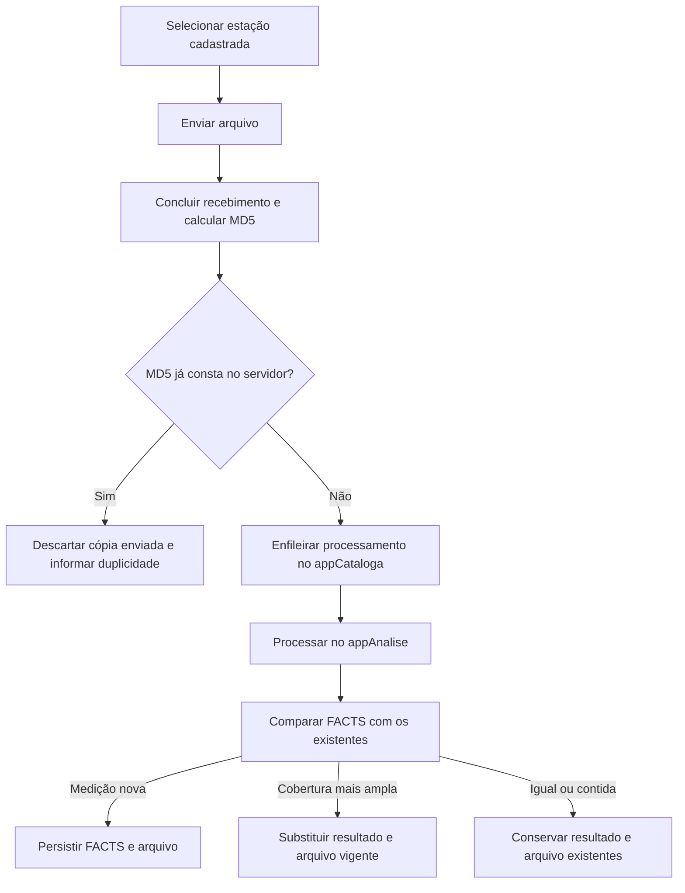

# Planejamento da ingestão manual e de drive-test

Data: 08/10/2026.
Status: planejamento. Este documento não altera a arquitetura vigente nem
implementa mudanças no banco, nas filas ou nos workers.

## Objetivo e limites

Ampliar o fluxo convencional, que funciona, para receber arquivos enviados
manualmente. Preservar descoberta, backup, processamento de parciais válidos,
identidade operacional e ciclo de vida das tasks existentes.

O fluxo fixo manual segue as regras abaixo. O próximo refinamento é o upload
de drive-test, com proteção por MD5 e resolução própria de estação/instrumento.
Não aplicar automaticamente as regras fixas ao móvel.

Não introduzir nesta etapa cadastro de estação fixa desconhecida, seleção de
linhagem pelo usuário ou um modelo geral de versões de arquivos.

## Regras confirmadas para estações fixas

1. **Estação obrigatória:** selecionar uma estação cadastrada antes de enviar
   os arquivos. A API também valida essa seleção. Não aceitar estação fixa
   desconhecida, criar host fictício ou tentar cadastrar estação pelo upload.
2. **MD5 como primeira proteção:** calcular no servidor o MD5 do arquivo recebido.
   Se esse MD5 já constar no servidor, descartar a cópia enviada, informar
   duplicidade e não criar novo processamento. Nome diferente não muda a regra.
3. **Conteúdo diferente passa pelo appAnalise:** MD5 diferente não permite decidir
   se a medição é nova ou uma cópia parcial ampliada. Essa decisão depende dos
   FACTS produzidos pelo processamento.
4. **Maior cobertura vence:** para FACTS da mesma medição, conservar aquele
   com cobertura temporal mais ampla e seu arquivo correspondente. Uma cópia
   menor enviada depois não pode reduzir o resultado disponível.

Exemplo: na mesma estação, local e configuração, o FACT de 1–2 Hz cobre
08:00–09:00. Outro arquivo produz o FACT correspondente de 08:00–10:00.
O resultado vigente passa a ser 08:00–10:00, com o arquivo mais completo.
Não manter os dois como medições independentes nem somar sua cobertura comum.

"Mais amplo" significa cobertura da medição após appAnalise, não tamanho em
bytes, data de upload ou nome do arquivo.

## Fluxo fixo manual

O WebFusion recebe arquivos e apresenta o resultado. O processamento no
appAnalise ocorre no appCataloga, fora da requisição HTTP. Não exigir que o
usuário conheça o caminho original da estação ou indique o arquivo substituído.

## Proteção por MD5 entre upload e backup

O MD5 precisa estar disponível para os arquivos do fluxo convencional e para
os uploads. Calcular apenas no upload não reconhece uma cópia que chegou pelo
backup sem MD5 registrado.

- Calcular sobre a cópia recebida que será processada, com transferência concluída.
  Arquivo parcial de aquisição pode ser válido; transferência interrompida não
  é a mesma condição.
- Guardar o MD5 do original recebido, inclusive quando o processamento gerar
  outro artefato. MD5 de MAT derivado não substitui o MD5 do BIN de entrada.
- Consultar o MD5 antes de enfileirar novo processamento. Revalidar a reserva
  sob concorrência para impedir que dois envios iguais gerem trabalho duplicado.
- Ao detectar duplicidade, remover somente a cópia pertencente ao novo upload.
  Conservar o arquivo já existente, seus FACTS e suas tasks.
- Resultado incompleto ou processamento anterior com falha requer recuperação
  da tarefa existente; duplicidade não deve ser anunciada como análise concluída.
- Para arquivos legados sem MD5, definir preenchimento controlado a partir dos
  originais disponíveis. Ausência de MD5 não comprova que o conteúdo seja novo.
  Não executar varredura ou backfill pesado em produção durante o planejamento.

O hash-path atual permanece no backup. Ele forma o nome a partir do host e
caminho remoto; não identifica os bytes. O upload não precisa reproduzi-lo.
Nomes originais ficam como informação do envio; o armazenamento manual deve
permitir conteúdos distintos com o mesmo nome, sem sobrescrita.

## Comparação dos FACTS e substituição do arquivo

A comparação ocorre após appAnalise, antes de alterar o resultado vigente.
Usar a identidade analítica existente para reconhecer a mesma medição: estação/
equipamento, site, procedimento, detector, tipo de traço, unidade e configuração
espectral. Para o caso confirmado, os FACTS têm o mesmo início temporal e um
possui término posterior. Não usar apenas coincidência de data e faixa para
misturar medições de estações ou configurações diferentes.

| Resultado | Ação |
|---|---|
| Não há FACT correspondente | Inserir o FACT e vincular o arquivo recebido |
| Mesma medição e mesma cobertura | Conservar o resultado vigente, sem duplicar |
| Novo FACT cobre integralmente o anterior e amplia o término | Substituir pelo resultado mais amplo e atualizar o vínculo com seu arquivo |
| FACT recebido está contido no vigente | Conservar o resultado e o arquivo mais amplos |
| Interseção sem contenção, parâmetros incompatíveis ou mudança de segmentação | Não aplicar substituição automática por maior duração; definir o caso com amostras antes de ampliar a regra |

A substituição precisa manter FACTS, vínculos e arquivo disponível coerentes.
Atualizar apenas `DT_TIME_END` e deixar o download apontando para o arquivo
menor não atende à regra.

Um arquivo pode conter vários FACTS. Só retirar integralmente o arquivo anterior
quando o novo arquivo cobrir todas as suas contribuições necessárias e não
houver outros vínculos que dependam dele. Se houver FACTS exclusivos do anterior,
preservá-los e conservar o arquivo necessário. Esse é o limite para implementar
"substituir o arquivo" sem perder medições.

Validar a saída completa antes da substituição. Persistir as alterações
analíticas em transação, conservar fatos compartilhados e excluir apenas órfãos.
Uma falha não pode deixar o resultado anterior removido sem o novo disponível.
Publicação física e banco não têm transação única: definir recuperação entre
essas etapas antes de remover a cópia antiga. A remoção física só ocorre depois
que o resultado novo e seu arquivo estiverem disponíveis e sem dependências.

Reenvios e conclusões concorrentes precisam conservar a maior cobertura,
independentemente da ordem de chegada. A checagem e a publicação devem usar o
mesmo critério, protegidas contra alterações concorrentes.

## Pontos de integração no código atual

- `modules/upload/service.py` já exige estação cadastrada para upload fixo.
  Hoje grava pelo nome seguro com criação exclusiva; não calcula MD5 nem cria
  processamento automático.
- `DIM_SPECTRUM_FILE` possui `NU_MD5`, mas `dbHandlerRFM.insert_file()` não o
  preenche. O método resolve o artefato por `(NA_VOLUME, NA_PATH, NA_FILE)`.
- `FILE_TASK` e `FILE_TASK_HISTORY` usam
  `(FK_HOST, NA_HOST_FILE_PATH, NA_HOST_FILE_NAME)`. Não substituir suas chaves
  por MD5 nem presumir que a pasta de upload seja o caminho remoto original.
- `insert_spectrum()` já compara FACTS pela identidade analítica e início
  temporal. Reutiliza o FACT mais amplo ou atualiza a linha existente quando
  recebe cobertura maior. Verificar os vínculos dos arquivos nessa ampliação.
- O reprocessamento convencional executa `reset_reprocessed_file_lineage()`
  dentro da transação analítica. Preservar seu comportamento atual. A integração
  manual não deve apagar os FACTS existentes antes de compará-los por supor que
  nomes iguais representam o mesmo arquivo de origem.

O ponto de entrada do upload na fila e a representação de sua origem precisam
ser definidos na arquitetura antes da implementação. Não decidir neste
planejamento que haverá fila própria ou worker novo sem essa revisão.

## Sequência de implementação do fluxo fixo

| Etapa | Entrega | Aceite |
|---|---|---|
| 1 | Contrato arquitetural da entrada manual e vínculo dos arquivos | Responsáveis definidos; nenhuma mudança implícita nas tasks convencionais |
| 2 | MD5 dos originais e consulta comum entre canais | Backup seguido de upload idêntico é descartado antes de novo processamento |
| 3 | Upload fixo conectado ao appCataloga/appAnalise | Estação obrigatória; conteúdo diferente analisado; nomes iguais não sobrescrevem |
| 4 | Comparação de cobertura e substituição coerente | FACT e arquivo de maior cobertura permanecem vigentes |
| 5 | Recuperação, concorrência e regressão | Falhas preservam dados; reenvio menor não regride; fluxo convencional continua funcionando |

Casos obrigatórios: mesmo BIN renomeado; BIN parcial de 30 MB seguido pelo de
90 MB; reenvio dos 30 MB; FACT 08:00–09:00 seguido por 08:00–10:00 e ordem
inversa; mesmo nome com conteúdos independentes; arquivo com vários FACTS;
fato compartilhado; envios simultâneos; falha de processamento; falha na
substituição; original BIN e derivado MAT com hashes distintos; upload sem
estação ou com ID inválido; regressão de RFEye/CWSM/ERMx/UMS.

Para validação de implementação: testes exclusivos de appCataloga no seu
container autorizado. Testes que importem WebFusion no webserver, em `/RF.Fusion`,
com `/usr/local/bin/python`. Usar bancos/diretórios isolados e monitorar recursos.
Nenhum teste de runtime é necessário para esta revisão documental.

## Drive-test: MD5 e identidade do instrumento

Premissa inicial informada pelo responsável: os arquivos de drive-test são
completos, sem o crescimento parcial observado nas RFEyes. Confirmar com amostras
dos formatos utilizados. Neste recorte, usar MD5 para impedir o processamento
repetido da mesma cópia, inclusive renomeada; não criar uma regra de sucessão
por maior cobertura para arquivos móveis.

Fluxo: `selecionar contexto móvel → receber arquivo → conferir MD5 →`
`descartar cópia idêntica ou processar no appAnalise → resolver instrumento →`
`persistir dados e arquivo`.

MD5 identifica a cópia recebida. Arquivos reexportados ou recompactados com bytes
diferentes não são reconhecidos por essa proteção; equivalência entre essas
exportações não faz parte desta etapa. Nome livre não é chave de deduplicação.

### Preservar a regra fixa ERMx/UMS300

`resolve_equipment_persistence_identity()` usa o hostname operacional para
decidir a exceção, não o modelo do analisador isoladamente:

| Contexto conhecido | Identidade persistida hoje | Tipo utilizado hoje |
|---|---|---|
| Host ERMx/EMRx | Hostname da estação | ERMx |
| Host UMS | Hostname da estação | UMS300 |
| Demais famílias fixas | Identificador normalizado do payload, com fallback do host | Inferido pela regra existente |

Preservar esse comportamento na coleta convencional e no upload fixo com
estação selecionada. Um EB500 recebido de UMS300 continua representando essa
estação no catálogo atual. Um analisador Tektronix, Keysight, Anritsu ou
Rohde & Schwarz recebido de ERMx não transforma a estação em estação móvel.

Trocar o instrumento de uma ERMx mantém sua identidade operacional. O código
atual já força também o tipo ERMx, independentemente do analisador. Isso protege
a continuidade da identidade, mas não comprova compatibilidade de todos os
instrumentos/parsers nem registra sozinho qual instrumento foi usado antes e
depois da troca. Testar essas condições separadamente.

### Separar estação/kit de instrumento físico

No drive-test, conservar dois conceitos sem mudar o significado dos registros
fixos já existentes:

- **Estação móvel/kit:** identidade permanente do conjunto de aquisição.
- **Instrumento:** fabricante, modelo e número de série do receptor/analisador
  usado naquela medição, quando disponíveis.

Modelo identifica um tipo; não identifica uma unidade física nem informa se
a aquisição é fixa ou móvel. Um EB500 móvel não deve virar UMS300. Um analisador
de um fabricante utilizado por ERMx não deve virar ERMx. O contexto de entrada
selecionado e validado determina qual regra aplicar.

Proposta para o móvel: usar cadastro/identificador interno do instrumento,
confrontado com fabricante, modelo e serial retornados pelo appAnalise. Se o
payload fornecer apenas o modelo, solicitar identificação do instrumento usado;
não criar uma identidade compartilhada para todas as unidades desse modelo.
Não inferir número de série a partir do nome do arquivo.

Se o kit trocar de instrumento, conservar a identidade do kit e associar as
novas medições ao instrumento utilizado. Preservar nas medições anteriores a
associação anterior; não atualizar seu equipamento retroativamente.

Guardar a identificação bruta retornada pelo appAnalise junto da associação
resolvida. Para as estações fixas híbridas, essa informação complementa a
identidade estável da estação, sem substituí-la. Local de persistência e vínculos
devem ser definidos na revisão arquitetural; não presumir nova tabela aqui.

### Limite do catálogo atual e validação

`get_or_create_spectrum_equipment()` procura o equipamento por `NA_EQUIPMENT`.
O DDL atual não possui campos próprios de fabricante/modelo/serial nessa dimensão.
Passar somente o modelo como nome no móvel pode fundir instrumentos distintos.
Antes de reutilizar esse método, definir a representação da identidade móvel
sem alterar os nomes, tipos e vínculos das estações fixas existentes.

Casos obrigatórios: EB500 em UMS300 e em kit móvel; dois instrumentos do mesmo
modelo com seriais diferentes; mesmo instrumento usado em contextos diferentes;
ERMx trocando fabricante/modelo; kit trocando instrumento; modelo sem serial;
serial divergente do instrumento selecionado; reenvio móvel idêntico com nome
diferente; regressão das identidades ERMx/UMS300 atuais.

## Drive-test: demais decisões preservadas

- Kit móvel permanente e campanha com identidade própria.
- Entradas previstas: ROMES, appAnalise e monitorRNI; confirmar compatibilidade
  dos formatos com amostras. Coletar identificação do instrumento quando disponível.
- Nome livre do arquivo não identifica a medição nem o kit.
- Processamento sem host fictício no Zabbix e sem aplicar ao móvel os ajustes
  de identidade específicos das estações fixas.
- Sites em `DIM_SPECTRUM_SITE`, com tipo `Mobile` e polígono em `GEOGRAPHIC_PATH`,
  calculado a partir dos pontos GPS. Conservar trajetória e contorno como
  conceitos distintos; validar o contrato de pontos retornados pelo appAnalise.
- Definir agrupamento da aquisição, formato/capacidade da geometria e tratamento
  de GPS insuficiente antes de implementar sites móveis. Não usar lookup de
  proximidade fixa para fundir trajetórias móveis com sites fixos.
- Rever consultas dependentes de host e a apresentação no WebFusion/MATLAB,
  preservando os contratos públicos dos summaries existentes.

Não presumir que coincidência espacial ou o mesmo kit permita aplicar a regra
fixa de substituição. A primeira entrega móvel usa a proteção por MD5 descrita
acima e mantém a identificação do instrumento separada da identidade do kit.

## Revisões técnicas necessárias antes de codificar

1. Onde persistir/consultar o MD5 do original quando houver conversão e como
   tratar os arquivos convencionais legados sem MD5.
2. Como representar o arquivo manual sem fabricar seu caminho remoto e como
   enfileirá-lo preservando os contratos operacionais existentes.
3. Como atualizar os vínculos e a disponibilidade física ao conservar o FACT
   mais amplo, inclusive para arquivos com vários FACTS.
4. Como recuperar falhas entre filesystem, RFDATA e BPDATA e impedir regressão
   sob concorrência.
5. Quais identificadores do instrumento cada formato retorna e como persistir
   a associação móvel e a identificação bruta sem alterar as identidades fixas
   ERMx/UMS300 nem reescrever o histórico após troca de instrumento.

Aplicam-se `ARCHITECTURE.md` §§0.1, 2–4 e 15.1.1: o contrato atual de upload
recebe arquivos sem criar tasks; sua ampliação exige atualização arquitetural.
Entrypoints continuam donos da fila, domínio processa dados e handlers de banco
concentram SQL. Preservar os contratos externos de summaries e as regras de
refatoração de `INSTRUCTIONS.md`. Nenhuma migração ou alteração de produção é
executada nesta etapa.
